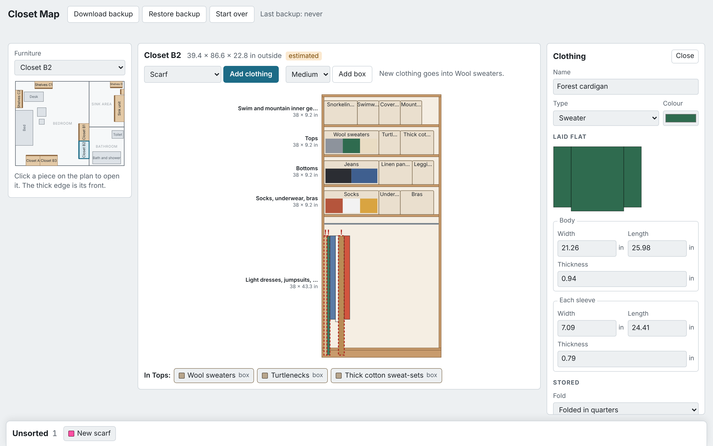

# Closet Map

A visual organizer for a real room: each piece of furniture is drawn to scale from its measurements, and you drag boxes and clothing between shelves, rails and boxes. "Closet Map" is a working title; `roomorg` is only the folder name.

This is the first iteration: the trunk (T1 to T8) of the skill tree in [`../tree/roomorg.json`](../tree/roomorg.json). Every later feature is a node in that tree.



## Run it

**In GitHub Codespaces (nothing to install).** On the repository page choose Code → Codespaces → Create codespace, wait for the editor to open, then in its terminal:

```bash
cd roomorg
```

```bash
npm install
```

```bash
npm run dev
```

Codespaces offers to open the page when the server starts. If the page does not load, stop the server with Ctrl-C and use the built version instead:

```bash
npm run build
```

```bash
npm run preview
```

**On your own computer.** Install Node.js (`brew install node` on a Mac), then run the same commands.

| Command | What it does |
| --- | --- |
| `npm run dev` | Starts the app with live reload |
| `npm test` | Runs the unit tests |
| `npm run typecheck` | Checks the types |
| `npm run build` | Type-checks and builds the static files into `dist/` |
| `npm run preview` | Serves the built files |

## Use it

| To do this | Do this |
| --- | --- |
| Open a piece of furniture | Pick it in the dropdown, or click it on the floor plan. The thick edge on the plan is its front. |
| Change a measurement | Type in the Measurements panel and press Enter. Lengths are in inches; `15 1/2` and `40 cm` also work. |
| Add a box or clothing | Click a compartment (or a box), choose a type or size, then **Add clothing** or **Add box**. With nothing selected it goes to the unsorted tray. |
| Move something | Drag it onto a shelf, a rail, a box or the tray. Or select it and use the **Where** list. |
| Reorder a shelf | Drag a thing left or right along it. |
| Carry something to another piece | Drag it to the tray, open the other piece, drag it out. |
| Pick up something thin | Click its compartment and drag its chip from the row under the drawing. |
| Fold something | Select it and choose a fold. Putting it on a rail hangs it; taking it off restores its fold. |
| See what a box holds | The stripes on a box are its contents. Click the box to open it. |

A dashed red outline with a `!` means the thing does not fit where it is: too wide, too tall, too deep, or too long to hang. Nothing is ever blocked; it is only flagged.

### Measurements

- Every piece has an outside size, panel thicknesses (sides, top, bottom, back), a shelf thickness, a divider thickness and a base height. The clear space in each compartment is worked out from those.
- You can type the inside width or depth instead, as a tape measure gives it, and the outside follows.
- A switch decides what gives when a compartment or thickness changes: the neighbouring compartment (the outside stays), or the outside (the other compartments stay). Use the second when typing in measured heights one after another.
- Pieces marked "estimated" have placeholder sizes. Only the two shelving units use real measurements so far.

### Your data

- Every change is saved in the browser straight away.
- Browser storage belongs to one address on one device and can be cleared, so **Download backup** regularly. The backup file is the real copy. **Restore backup** loads one; a damaged file is refused with the reason and changes nothing.
- **Start over** returns to the starter room. It asks for a second click.

## How the code is laid out

Dependencies point one way: `ui` uses `state`, and both use `model`. `model` knows nothing about the browser or React, so it is easy to test and can be reused when the Three.js room view arrives.

### `src/model/`: the rules, in plain TypeScript

| File | What it holds |
| --- | --- |
| `types.ts` | The saved data: `Home`, `Room`, `Furniture`, `Column`, `Cell`, `Organizer`, `Item`. Flat lists that point at their parent by id. All lengths in cm. |
| `roomData.ts` | `createStarterHome()`: the suite, its furniture and compartments, and the boxes from the organization table. |
| `furniture.ts` | `clearSpaces()` works out each compartment's space. `resizePiece`, `resizeCompartment`, `resizeColumn` and `setThickness` change measurements and keep the piece adding up. |
| `folding.ts` | `flatOutline()` is the laid-flat shape. `storedSize()` is the single box an item takes up for its fold. |
| `layout.ts` | `arrange()` decides where everything in a compartment or box is drawn, and what does not fit. |
| `tree.ts` | Where things are: `childrenOf`, `move`, `remove`, `addItem`, `addOrganizer`, `updateItem`, `updateOrganizer`, `pathTo`, `destinations`. |
| `parse.ts` | `parseHome()` checks a saved home or backup file before it is used. |
| `presets.ts` | Box sizes, clothing types with starting sizes, fold options and limits. |
| `units.ts` | Inches for display, cm for storage; reading typed lengths. |
| `refusal.ts`, `ids.ts` | The error type for a refused edit; new ids. |

### `src/state/`: what is on screen, and saving

| File | What it holds |
| --- | --- |
| `store.tsx` | One store: the home, the open piece, the selection, the resize switch and the notice line. Screens change the home through `edit` or `tryEdit`. |
| `persistence.ts` | Autosave, loading, and backup files. |

### `src/ui/`: the screens, in React

| File | What it holds |
| --- | --- |
| `App.tsx` | The page layout. |
| `Header.tsx` | Backups and the notice line. |
| `FurniturePicker.tsx` | The dropdown and the floor plan. |
| `FurnitureView.tsx` | The to-scale front view, and the row of chips for the selected compartment. |
| `Contents.tsx` | Draws the boxes and clothing inside a compartment or a box. |
| `MeasurePanel.tsx` | The measurements of the open piece. |
| `ItemEditor.tsx` | The side panel for a selected clothing item or box. |
| `AddBar.tsx` | Adding clothing and boxes. |
| `UnsortedTray.tsx` | The tray along the bottom. |
| `ThingChip.tsx` | A named, draggable chip for a box or an item. |
| `drag.tsx` | Dragging with mouse or touch, built on pointer events. |
| `parts.tsx` | Shared pieces: the length and name fields, the two-step button, small helpers. |
| `ui.css` | Styling, with light and dark colours. |

## How it works

**Furniture adds up.** In each column, the compartment heights plus the shelves between them must equal the inside height; across a piece, the column widths plus the dividers must equal the inside width. Every measurement edit ends by restoring that rule with one of two small helpers (`giveToLargest`, `tradeWithNeighbour`), or it is refused.

**Folding keeps the fabric.** A garment laid flat is a body with optional sleeves or legs. Its fabric volume is the sum of each part's width × length × thickness. A fold divides the footprint, so the height rises to keep the volume the same. Sleeves and legs add volume, which makes a folded item thicker without making it wider.

**Arrangement is automatic.** You choose the place and the order; `arrange()` chooses the position. On a shelf, things run left to right and loose clothing stacks into piles. On a rail, clothing hangs side by side and boxes sit on the floor underneath.

**Edits are refused, not broken.** Model functions return a new home or throw a `Refusal` with a sentence written for the person using the app. `tryEdit` in the store catches it, leaves the home untouched, and hands the sentence back to the field that asked.

**Saved files are checked whole.** `parseHome()` checks every record's shape, then that the records fit together (parents exist, ids are unique, furniture adds up). A file that fails is refused with the reasons.

## Tests

```bash
npm test
```

62 unit tests cover clear spaces and resizing, folding, arrangement, moving and removing, saved-file checking, and reading typed lengths. The screens were checked with a scripted browser run of 44 steps: opening every piece, each kind of measurement edit, dragging between a box, a shelf, a rail and the tray, folding, reload, backup, start over and restore.

## Known limits

- The front view shows width and height. Depth is checked when deciding whether something fits, but not drawn.
- Furniture positions, facing and compartment layout are fixed in `roomData.ts`. Editing them in the app is nodes R7 and R9.
- Something laid flat is very thin in the drawing; use its chip under the drawing to grab it.
- Pressing on a box or item with a finger starts a drag instead of scrolling the page. Scroll from the empty areas.
- Data lives in one browser. Syncing between devices is node D5.

## More

- [`docs/DESIGN.md`](docs/DESIGN.md): decisions, your feedback word for word, the pseudocode, and why each library was or was not used.
- [`../tree/`](../tree/): the skill-tree page and this project's tree.
